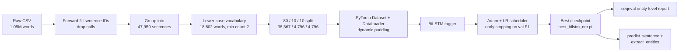

<div align="center">

# 🧠 Named Entity Recognition with a BiLSTM (PyTorch)

### Teaching a neural network to find **people, places, organisations, dates and more** in raw text, trained from scratch on ~48,000 sentences.


-blueviolet)


</div>

---

## 📌 Executive Summary

Unstructured text (news, emails, resumes, support tickets, contracts) holds valuable facts, but a computer cannot use them until it knows **who, where, what and when** a sentence is talking about. This task is called **Named Entity Recognition (NER)**.

This project builds an end-to-end NER system **from scratch**: data cleaning, vocabulary building, a custom PyTorch data pipeline, a **Bidirectional LSTM** tagger, training with early stopping and learning-rate scheduling, strict entity-level evaluation, and an interactive prediction function that turns a plain sentence into a list of labelled entities.

| | |
|---|---|
| **Test entity-level F1 (micro)** | **0.82** (precision 0.82, recall 0.82) on 11,322 held-out entities |
| **Strongest categories** | Geopolitical entities **0.95**, Time **0.87**, Geographic **0.86** |
| **Model size** | 2.68 M parameters (light enough to train on a laptop) |
| **Training data** | 47,959 sentences, 1,048,575 words, 17 BIO tags, 8 entity types |
| **Honest caveat** | Rare classes (artifacts, events) remain weak; see the [audit](#-engineering-audit-known-limitations) |

> ✅ **Independently verified.** The reported test scores were re-computed from the saved checkpoint (`best_bilstm_ner.pt`) with a separate NumPy re-implementation of the network. The result matched the notebook: micro F1 **0.8195**, validation F1 **0.8153**.

---

## 🎯 Why This Matters (Business Value)

Entity extraction is a building block behind many real products:

| Use case | How NER helps |
|---|---|
| **Resume / CV screening** | Pull out names, employers, institutions, dates and locations automatically |
| **News & media monitoring** | Track which organisations, people and places appear in the headlines |
| **Customer-support routing** | Detect products, locations and dates inside tickets |
| **Compliance & KYC** | Flag people, companies and jurisdictions in documents |
| **Search & knowledge graphs** | Turn free text into structured, queryable records |

---

## 🔍 Live Demo (real model output)

```python
"Barack Obama visited Paris and met with Emmanuel Macron"
→ Barack Obama [per] · Paris [geo] · Emmanuel Macron [per]        ✅

"The United Nations held a meeting in New York on Monday"
→ United Nations [org] · New York [geo] · Monday [tim]            ✅

"Google announced a partnership with Microsoft in San Francisco"
→ Google [org] · Microsoft [org] · San Francisco [geo]            ✅

"Elon Musk founded Tesla in 2003"
→ Elon Musk [per] · 2003 [tim]                                    ⚠️ "Tesla" missed

"Apple Inc was founded by Steve Jobs in California"
→ Apple Inc [org] · Steve [per] · California [geo]                ⚠️ "Jobs" mis-tagged as O
```

Six hand-written sentences are a **sanity check, not a benchmark**. The misses are shown on purpose. The benchmark is the 4,796-sentence test set below.

---

## 🗂️ Dataset

| Property | Value |
|---|---|
| File | `ner_dataset.csv` (annotated NER corpus, Kaggle / Groningen Meaning Bank style) |
| Rows (words) | 1,048,575 |
| Sentences | 47,959 (min length 1, max 104, mean 21.9, 95th percentile 35 words) |
| Columns | `Sentence #`, `Word`, `POS`, `Tag` |
| Tag scheme | **BIO** (`B-` begins an entity, `I-` continues it, `O` is outside) |
| Entity types | `per` person · `geo` geographic · `gpe` geopolitical · `org` organisation · `tim` time · `art` artifact · `eve` event · `nat` natural phenomenon |

**Class imbalance is severe.** About **84.7 %** of all tokens are `O`. Of the 111,891 entity starts, `geo` has 37,644 while `nat` has only 201. This is why entity-level F1 is used instead of plain accuracy (see [metrics](#-results)).

---

## ⚙️ Pipeline



---

## 🏗️ Model Architecture

```
Input tokens → Embedding (18,802 × 128) → Dropout(0.3)
             → Bidirectional LSTM (1 layer, 128 hidden units per direction → 256)
             → Dropout(0.3)
             → Linear (256 → 17 BIO tags)
```

| Setting | Value |
|---|---|
| Parameters | **2,675,217** |
| Loss | Cross-entropy, padding positions ignored (`ignore_index=-1`) |
| Optimiser | Adam, learning rate 1e-3 |
| Scheduler | `ReduceLROnPlateau` (patience 2, factor 0.5) on `1 − val F1` |
| Regularisation | Dropout 0.3, gradient clipping at 5.0 |
| Training | Up to 20 epochs, batch size 32, early-stopping patience 5, best checkpoint saved by validation F1 |
| Hardware | Apple Silicon GPU (PyTorch `mps` backend) |

**Why a BiLSTM?** A forward LSTM reads a sentence left to right; a backward LSTM reads it right to left. Joining both lets the model use context on both sides of a word. In "Washington *signed* the bill" versus "he flew to Washington *yesterday*", the neighbours decide whether the word is a person or a place.

---

## 📈 Results

### Training behaviour

<div align="center">

</div>

- Training loss fell steadily, from roughly **0.39** to **0.07**.
- Validation F1 climbed from roughly **0.70** after epoch 1 to a best of **0.8153**, then plateaued from around epoch 10 while training loss kept falling. This is the usual sign that the model has extracted most of what its capacity and data allow.

### Final test-set report (entity level, `seqeval`)

| Entity | Precision | Recall | F1 | Support |
|---|---:|---:|---:|---:|
| `gpe` (geopolitical) | 0.96 | 0.94 | **0.95** | 1,592 |
| `tim` (time) | 0.88 | 0.87 | **0.87** | 1,990 |
| `geo` (geographic) | 0.84 | 0.89 | **0.86** | 3,819 |
| `per` (person) | 0.75 | 0.75 | 0.75 | 1,731 |
| `org` (organisation) | 0.68 | 0.63 | 0.66 | 2,095 |
| `nat` (natural phenomenon) | 0.67 | 0.62 | 0.64 | 13 |
| `eve` (event) | 0.48 | 0.29 | 0.36 | 34 |
| `art` (artifact) | 0.33 | 0.02 | 0.04 | 48 |
| **micro average** | **0.82** | **0.82** | **0.82** | **11,322** |
| macro average | 0.70 | 0.63 | 0.64 | 11,322 |
| weighted average | 0.82 | 0.82 | 0.82 | 11,322 |

### How to read these numbers

- **0.82 is a micro-averaged, entity-level F1.** An entity counts as correct only if its *whole span and type* are right. "New York" tagged as just "New" is wrong. This is stricter than word-level accuracy.
- **Word-level accuracy is 96.6 %**, but a model that predicted `O` for every word would already score about 84.7 %. That is why accuracy is not used as the headline metric.
- **Macro F1 is only 0.64** because the rare classes (`art`, `eve`, `nat`) pull the average down. The model is strong on frequent classes and weak on rare ones.

---

## 🚀 Getting Started

```bash
git clone https://github.com/vishnusai2005/<your-repo-name>.git
cd <your-repo-name>
pip install torch pandas numpy scikit-learn matplotlib seqeval
jupyter notebook BILSTM_NAME_ENTITY.ipynb
```

Run the notebook top to bottom. Before running, change the CSV path in the data-loading cell to `ner_dataset.csv`; the notebook currently points at an absolute path on the author's machine.

> **Note:** the vocabulary (`word2idx`) is rebuilt deterministically from the dataset and is **not** stored inside `best_bilstm_ner.pt`. Run the vocabulary cells before loading the checkpoint.

### Repository layout

```
├── BILSTM_NAME_ENTITY.ipynb   # full pipeline: data → model → evaluation → demo
├── best_bilstm_ner.pt         # trained weights (best validation F1)
├── ner_dataset.csv            # annotated corpus
├── assets/
│   └── training_curves.png    # loss and validation-F1 plot
└── README.md
```

---

## 🔬 Engineering Audit: Known Limitations

Every finding below was confirmed by reading the code and re-running the saved checkpoint. They are listed openly because knowing a model's weak points is part of shipping it responsibly.

| # | Finding | Impact | Planned fix |
|---|---|---|---|
| 1 | **The LSTM is single-layer, not two-layer.** `BiLSTM_NER` accepts `num_layers=2`, but the value is never passed to `nn.LSTM`. PyTorch's warning in the notebook confirms it. The checkpoint contains only layer-0 weights. | The in-LSTM dropout has no effect, and the architecture is smaller than the argument suggests. All figures in this README describe the real single-layer model. | Pass `num_layers=num_layers` to `nn.LSTM`, retrain and compare |
| 2 | **Training log not preserved.** The saved training cell shows a `KeyboardInterrupt` and no per-epoch printout. | Epoch-by-epoch numbers cannot be read from the notebook. The plot and checkpoint are consistent, since the checkpoint re-scores 0.8153 validation F1. | Re-run once to a clean, logged finish |
| 3 | **Naive whitespace tokenisation in `predict_sentence`.** `"Paris."` stays one token, becomes `<UNK>`, and is tagged `O`; `"Paris ."` is tagged `B-geo`. | Punctuation can silently hide entities at inference time. | Use a real tokeniser (spaCy / NLTK) that matches the training data |
| 4 | **`extract_entities` ignores type consistency.** An `I-` tag is merged into the open entity even if its type differs from the `B-` tag. | Possible malformed spans. | Require matching entity types when merging |
| 5 | **Vocabulary built on the full dataset before splitting.** Roughly 1.3 % of test tokens map to `<UNK>`. | Minor leakage of vocabulary membership, though no labels leak. Words seen only in validation or test never get trained embeddings. | Build the vocabulary from the training split only |
| 6 | **Severe class imbalance and no class weighting.** | `art` F1 is 0.04 and `eve` is 0.36. | Weighted loss, oversampling, or a CRF layer |
| 7 | **All text is lower-cased.** | Capitalisation is a strong NER cue ("Apple" vs "apple"). This is a likely contributor to the weaker `org` and `per` scores (a hypothesis, not tested). | Add case or character-level features |
| 8 | **Independent argmax decoding.** | The model can emit invalid BIO sequences (e.g. `I-org` after `O`). | Add a CRF decoding layer |
| 9 | **No random seeds for PyTorch or NumPy.** Only the data split is seeded. | Retraining will not reproduce scores exactly. | Add `torch.manual_seed` and `np.random.seed` |
| 10 | **Notebook hygiene.** `pip install seqeval` is run twice, the "Best validation F1" print sits inside the epoch loop, a stray `label_seq` debug cell remains, 31 of 53 cells are empty, and the dataset path is hard-coded. | Cosmetic, but it makes the notebook harder to review. | Tidy before the next version |

**One concern checked and cleared:** the notebook pads sentences in each batch without packing them, which could in theory make scores depend on batch composition. Scoring each test sentence individually gave F1 **0.8192**, versus **0.8195** in padded batches, so the effect is negligible.

---

## 🛣️ Roadmap

- [ ] Fix the layer-count bug (#1) and re-benchmark the two-layer model
- [ ] Add a **CRF** output layer for valid BIO sequences
- [ ] Add **character-level embeddings** and case features for rare and unseen words
- [ ] Try pre-trained embeddings (GloVe / fastText) and a transformer baseline (BERT / DistilBERT) for comparison
- [ ] Handle class imbalance (weighted loss) to lift `art`, `eve` and `nat`
- [ ] Wrap the predictor in a small **Streamlit / FastAPI** demo app
- [ ] Save the vocabulary alongside the weights so inference needs only the checkpoint

---

## 🧰 Tech Stack

**Python · PyTorch · NumPy · pandas · scikit-learn · seqeval · Matplotlib · Jupyter**

**Skills demonstrated:** NLP sequence labelling · custom `Dataset` / `DataLoader` / collate functions · BiLSTM design · training loops with early stopping, LR scheduling and gradient clipping · entity-level evaluation · class-imbalance analysis · error analysis and honest reporting.

---

## 👤 Author

**Vishnusai Vydhyam**
Final-year B.Tech, Computer Science Engineering (AI & ML), Mohan Babu University, Tirupati
Seeking **Machine Learning / Data Science / AI Engineer** roles and internships.

[](https://github.com/vishnusai2005)
[](https://www.linkedin.com/in/vishnusai-vydhyam)

---

<div align="center">

⭐ If you found this project useful, please consider starring the repository.

</div>
